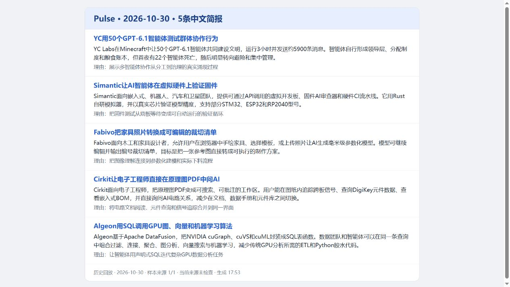

# Pulse

[](https://github.com/NeverBeforr/ai-pulse-agent/actions/workflows/ci.yml)

每天北京时间约8点，最多5条、每条最多140字的中文AI简报，推到你自己的飞书。



历史简报回放，由飞书payload离线渲染；不是今天的新资讯或真实群聊送达截图。[查看回放来源](docs/demo.md)

```bash
uvx --from git+https://github.com/NeverBeforr/ai-pulse-agent@v0.3.0 pulse demo
```

部署：[Fork → 配置2个Secrets和2个Variables → 手动验证 → 开启每日Actions](docs/quickstart-actions.md)

试读命令无需clone或密钥；首次安装会下载代码和依赖，安装后的回放不联网。当前从Git标签分发，PyPI发布尚待后续。

---

## 一次执行，完成后退出

`pulse run`读取pulse.yaml，从RSS、Hacker News和TLDR公开归档获取内容，跨天去重，默认一次模型调用生成中文摘要，投递到用户自己的飞书或markdown文件，然后退出。没有后台服务和内置调度器。TLDR邮箱是可选来源。

首发部署使用GitHub Actions：在仓库填写LLM_API_KEY、FEISHU_WEBHOOK两个Secrets，以及LLM_BASE_URL、LLM_MODEL两个Variables。密钥只通过环境变量注入；首次手动验证后，再启用每天北京时间约8点的定时执行。详细设置在部署文档。

## 命令

```bash
pulse demo                         # 回放历史真实简报，不需要密钥
python -m ai_pulse demo            # 同一CLI入口，不启动Web
pulse run --dry-run                # 严格离线预览，不投递、不写去重状态
pulse check                       # 校验真实配置与环境变量，不探测网络
pulse run                         # 执行一次并退出
pulse status --json               # 查询最后运行、来源和投递状态
pulse init --from-legacy data/settings.json --out pulse.local.yaml
```

`--config`或PULSE_CONFIG选择配置；`--date YYYY-MM-DD`用于回溯。`--json`的stdout只有一个JSON对象，日志在stderr。

demo使用历史公开材料，经真实解析、临时存储与排序后，回放录制的中文摘要。dry-run额外读取配置，并明确区分样本来源与未检查的当前来源；未绑定变量会列出。它们不证明模型、来源或飞书已经连通。

## 可见的失败

| 退出码 | 含义 |
| --- | --- |
| 0 | 来源及输出正常，达到目标且至少一个sink确认成功 |
| 1 | 部分或降级：来源／输出有失败、未达到目标，或已存库但未送达 |
| 2 | 配置错误，包括缺环境变量、未知字段或明文密钥 |
| 3 | 运行错误，包括模型、数据库或结果校验失败 |
| 4 | 无有效内容，包括全源失败或去重后没有候选 |

所有来源失败时不会用旧缓存冒充今天的新简报。内容已经保存但所有输出失败时返回degraded/1；重跑优先重试失败投递，已确认成功的通道不会重复发送。

## 状态与边界

每次运行创建并关闭网络客户端。PoolTimeout被判为客户端故障，最多整体重建一次。HN热度在各自来源中归一，不再以原始分数压过其他来源。

进程不驻留，去重和投递状态持久保存在SQLite。Actions通过同分支的状态制品恢复数据库，保留14天；制品过期或被删除可能导致重复推送。不承诺端到端严格恰好一次，详见部署文档。

默认最多20个候选进入模型，正常只调用一次；JSON结构校验失败最多纠正一次。发送前按UTF-8字节数保守控制输入预算，服务商报告计数异常时会缩减候选，整个生成最多两次请求。摘要数字约束写入提示词，未宣称自动事实核验。

主路径支持RSS/Atom、HN、TLDR公开归档与只读IMAP邮件。公众号抓取、SMTP和Cloudflare运行时尚未实现。旧Web与多轮agent代码保留但冻结，不是默认部署路径。

## 开发与验收

Python3.11或3.12，包名保持ai_pulse。

```bash
pip install '.[dev]'
pytest -q
ruff check .
pulse demo
pulse run --dry-run --config tests/fixtures/pulse.yaml
```

测试只用样本和临时状态，不读取真实.env，不访问网络、不调用真实模型或机器人。

工程检查与真实运行的边界见[当前状态](docs/status.md)。连续三天Actions实测尚待首次投递和后续运行，历史回放和离线测试不替代真实验收。

## 资料

- [v0.3改造规格](docs/REFACTOR_SPEC_v0.3.md)
- [本地与迁移说明](docs/quickstart-local.md)
- [Actions部署说明](docs/quickstart-actions.md)
- [变更记录](CHANGELOG.md)
- [贡献指南](CONTRIBUTING.md) · [添加来源](docs/adding-a-source.md) · [添加输出通道](docs/adding-a-sink.md)
- [报告问题](https://github.com/NeverBeforr/ai-pulse-agent/issues/new/choose) · [安全说明](SECURITY.md)

原创代码继续使用MIT许可证，第三方内容与依赖保留各自许可。
