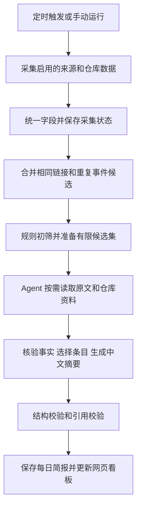

# AI 信息变化追踪 Agent 开发方案

版本：0.1 原始规划，已进入本地实施。日期：2026 年 10 月 28 日。项目暂名：AI Pulse Agent。

开发位置：`E:\ai-pulse-agent`。用户现已授权本地开发，并指定使用 Conda、先保证本地运行、模型 API 最后接入测试。本文保留原始规划，最新实现与阶段调整见 LOCAL_STATUS.md。

最新产品定位见 PRODUCT_PLAN.md：行业热点与真实产品案例各半，默认中文阅读 3 至 5 分钟，摘要本身完成信息交付。与本文早期内容定位不一致处，以最新产品方案及用户后续修订为准。

## 1 项目目标

为关注 AI 的个人用户集中发现重要消息，减少在多个网站和公众号之间切换及漏看。每天上午 9 点启动简报生成流程，输出最多 10 条中文内容，在本机网页中阅读。

简报包含 AI 产品与模型动态，以及近期受到关注的 AI 开源项目。前者优先关注模型发布、重要产品功能、API 与价格变化；后者以近期热度为主要排序依据。具体消息和数据须有来源，缺少足够内容时少于 10 条，不凑数。

项目面向真实个人使用和 GitHub 开源展示。第一版先做好采集、筛选、核验、简报和历史记录这一条完整链路。

## 2 已确认的需求

| 项目 | 已确认选择 |
| --- | --- |
| 核心价值 | 避免漏掉分散在各处的重要消息 |
| 主题 | 国内外 AI 产品、模型，以及 AI 相关 GitHub 项目 |
| 关注方式 | 内置来源清单，支持用户增删和启停 |
| 国外来源 | Hacker News、TLDR AI、TLDR 科技主刊；官方来源用于补充及核验 |
| 国内来源 | 机器之心、量子位、新智元，再补充 2 至 3 个主流公众号候选 |
| GitHub 重点 | 发现近期受到关注的项目，以近期热度为主要依据 |
| 简报 | 每日一份，最多 10 条，合并重复消息，保留历史 |
| 使用入口 | 中文网页看板 |
| 运行方式 | Windows 电脑本地运行，单用户 |
| 时间 | 每天上午 9 点，Asia/Hong_Kong，即 UTC+8 |
| 模型 | 云端 API，用户自行配置密钥并承担费用 |
| 费用 | 暂不设固定预算，先测效果与消耗，再决定上限；此项采用用户最后的 C 选项 |
| 采集费用 | 免费渠道优先；需要登录或付费的来源另行评估 |
| 实施顺序 | 先审阅本方案，用户确认后开发 |

以下为可调整的实现默认值：界面以中文为主；本机监听地址为 `127.0.0.1`；无需注册账号；同一日保留一份当前简报及其修订记录；用户可手动刷新；无固定新闻与 GitHub 项目配额，按当天价值混合排序。

## 3 第一版范围

### 3.1 必须完成

1. 模型连接设置和一次真实工具调用兼容性检查。
2. 内置信息源清单，支持来源增删、启停、状态和最近成功时间。
3. 自动采集 Hacker News、TLDR AI、TLDR 科技主刊，以及 GitHub 公开仓库数据。
4. 将六个国内媒体候选纳入清单，分别记录公众号原生渠道、官网渠道、可用订阅渠道的状态；只启用验证成功的免费渠道。
5. 持续发现 AI 相关 GitHub 项目，保存候选项目的 Star 数快照和观测时间。
6. 对候选内容去重、判断主题相关性，由 Agent 按需读取原文和仓库资料，完成核验、筛选和中文摘要。
7. 每日上午 9 点运行每日简报流程；支持启动补生成和手动运行。
8. 每日最多 10 条；每条含来源、时间、摘要、入选理由和相关链接。
9. 首页、历史、来源管理、运行记录与设置页面。
10. 显示采集覆盖情况、任务状态、模型用量，以及有价格配置时的估算费用。
11. 提供可离线查看的演示数据和面向他人的安装说明。

### 3.2 暂不纳入

第一版不做账号体系、公开多用户托管、邮件或聊天工具推送、移动 App、本地模型、多 Agent 协作、自动修改代码、付费媒体接入、全网无限检索，以及公众号的长期登录自动化。后续需求独立排期。

用户可以管理两类追踪对象：可直接配置的 RSS 或已适配站点，以及 GitHub 的 AI 主题查询。普通网页可以添加为待适配来源，但不承诺任意 URL 都能自动提取栏目与全文。

## 4 信息源与接入策略

### 4.1 国外来源

| 来源 | 第一版接入方式 | 内容用途 | 当前核验结论 |
| --- | --- | --- | --- |
| Hacker News | 官方 Firebase API 的 top、new、show 列表及 story 元数据，初筛 AI 相关条目 | 新闻线索、讨论热度、GitHub 项目发现 | 已读取官方 API 文档；实际连接和字段解析在开发阶段验证 |
| TLDR AI | 公开归档页发现每期链接，再解析文章条目与原文链接 | AI 新闻、研究与工具线索 | 2026-10-28 已读取归档页并看到按日期发布的条目；单期解析待实现 |
| TLDR 科技主刊 | 公开站点及归档中的文章条目，保留 AI 相关部分 | 开发工具、AI 产品补充 | 2026-10-28 已读取主页面；归档发现与单期解析待验证 |
| AI 官方来源 | 已验证 RSS、官方博客、发布文档；初始覆盖 OpenAI、Anthropic、Google、DeepSeek、Qwen 等生态 | 补充新闻、核验模型与产品变化 | 每个实际 URL 和可用解析方式在第一阶段登记 |

Hacker News 的讨论热度是社区信号，不作为事实已确认的证明。TLDR 是线索来源，优先继续读取其链接指向的原始公告。TLDR AI 的官方介绍说明其在工作日发送，因此周末允许该来源没有新内容。

第一阶段建立约 12 至 20 个有效订阅或官方入口，候选条数有单次上限。此数量是实施目标，不是对所有来源可访问性的承诺。

### 4.2 国内来源与公众号

| 来源名称 | 选择状态 | 主要定位 |
| --- | --- | --- |
| 机器之心 | 用户指定 | AI 研究、模型与产业动态 |
| 量子位 | 用户指定 | AI 产品、模型、技术与产业动态 |
| 新智元 | 用户指定 | AI 模型、研究与热点 |
| AI科技评论 | 补充候选 | AI 技术、研究与产业 |
| 极客公园 | 补充候选 | AI 产品和科技行业，过滤无关主题 |
| InfoQ | 补充候选 | AI 工程、开发工具与实践 |

上述后三个名称是建议补充的媒体／公众号候选，不代表已完成公众号账号身份或采集渠道验证。第一阶段核对准确账号名称、公开主页和可获取内容的渠道。

按以下顺序验证免费接入：

1. 账号或媒体自行提供的公开 RSS、公开文章列表或无需登录的内容入口。
2. 同一媒体官网中可公开访问的文章，注明实际来源为官网，并记录是否确认为公众号同文。
3. 已存在且无需登录或付费的订阅桥接服务，先检查更新及时性与稳定性。
4. 如没有可用自动渠道，保留为“待接通”，允许手动添加公开文章链接。

官网来源与公众号原生来源分别记录。不能把“抓到了官网文章”标成“已完整覆盖该公众号”。不预设存在免费、完整、稳定的公众号统一接口。

六个候选都进入来源清单，实际启用数量以验证结果为准。机器之心、量子位、新智元各自须有明确验证结论。若用户指定账号缺少免费自动入口，应交付缺口清单供用户决定是否接入第三方；不静默删除需求，也不自动购买服务或请求个人微信登录。

### 4.3 GitHub 项目发现

候选入口包含三部分：Hacker News 或 TLDR 中的仓库链接、按 AI 主题执行的 GitHub 仓库搜索，以及本地最近观察过的项目。GitHub Trending 公共网页可作为验证后的辅助入口，不作为唯一依赖。

主题范围包括 Agent、LLM、模型推理、RAG、AI 编程、生成式 AI 及相关开发工具。过滤明确无关、已归档或仅搬运营销材料的候选；不把“新项目”限定为最近创建的仓库，成熟项目近期突然受到关注也可入选。

仓库搜索分开查询近期创建和近期活跃的 AI 项目，使用主题、关键词、创建时间等条件缩小候选范围。按总 Star 数排序仅能提供候选，不能直接代表近期增长。

GitHub REST API 对匿名请求和搜索分别有限流。支持可选的 GitHub Token，第一版仅访问公开只读数据，无 Token 时降低请求量，并在受限时展示缺失状态，不循环重试。

## 5 GitHub 热度的计算与说明

### 5.1 有观测数据时

采集时保存 `repo_id`、Star 总数、观测时间和数据来源。若存在约 24 小时或 7 天前的快照，使用差值作为“观测窗口内 Star 净增”。窗口允许小幅偏差，但展示实际起止时间或观测时长。

例如展示“近 26 小时净增 180 Star”，而不是写成精确的“今日新增 180”。差值可能为负，不擅自改成零；不同窗口的增长先按时间尺度和候选分位进行比较。

排序主要采用增长速度，结合 HN 的近期得分、讨论量和是否出现于多个独立来源。总 Star 数用于背景说明。基本 AI 相关性与仓库可访问性作为入选条件。

初始权重建议：近期增长信号 65%、HN 讨论信号 20%、独立来源出现信号 15%。各项先转为当前候选集合的分位值；缺失指标不当作零分，有足够指标时对已有权重重新归一。权重属于可调整默认值，先通过样例比较验证，不作为科学或全网排名结论。

### 5.2 冷启动与电脑关机

首日尚无历史快照时，展示“首次观察，暂无增长历史”。使用 HN 当前讨论、TLDR 近期推荐和可用的 Trending 数据作为热度线索，标注具体来源；不生成虚构的日增 Star。

电脑关机期间不会产生本地采样。跨多日的两次采样只能说明整个间隔的净增，不能推断每一天的增长。第一版不为补齐这些数据而抓取全部 Star 用户历史。

默认最多维护 100 个近期活跃候选；超过 14 天没有再被发现且未入选的候选退出高频采样。普通采集单次刷新最多 20 个仓库，轮转覆盖候选集合；快照的实际时间随数据展示。

## 6 采集与简报工作流



普通采集不调用模型。先用发布时间、主题、重复链接和热度元数据缩小范围，再将每日最多 40 个候选交给模型。全文按需读取，避免把所有网页内容反复发送。

URL 去重移除已知跟踪参数，但保留会影响文章身份的查询参数。HN、TLDR 和公众号报道同一事件时合并成一个事件，保留多个来源；模型只提出语义合并候选，事件归属和使用依据写入记录。

默认不重复推荐最近 7 天已入选的相同事件或项目。若有重大新进展，允许再次入选，并明确新增内容。新闻事件和同一事件关联的 GitHub 项目尽量合并，避免挤占 10 条上限。

## 7 Agent 的职责与执行边界

采用单个编辑 Agent，通过模型的工具调用能力完成按需查证。常规采集、持久化、配额、排序信号和定时任务由程序处理。

| 工具 | 用途 | 参数与返回约束 |
| --- | --- | --- |
| `read_article` | 读取候选文章正文 | 输入已登记的候选 ID；返回正文、来源 URL、发布时间和抓取状态 |
| `read_repository` | 读取仓库 README 与公开元数据 | 输入候选仓库 ID；返回截断后的说明和元数据，不执行仓库代码 |
| `find_related_evidence` | 为候选寻找官方或相关来源 | 输入候选 ID；优先查询已配置来源中的内容及候选已有外链，返回有限证据列表 |
| `read_previous_coverage` | 检查是否已经报道及有何新进展 | 输入事件或仓库 ID；返回近期入选记录 |

`find_related_evidence` 不代表接入未配置的商业搜索引擎。第一版只在已采集内容、已配置官方入口和候选外链内寻找；证据不足时保留媒体报道属性或放弃候选。

Agent 根据现有材料决定需要调用哪些工具、是否继续查证、是否合并、是否入选。没有需要查证的内容时可以直接生成，不强制为了展示 Agent 而调用工具。

默认单次简报最多 6 轮模型交互、总计 12 次工具调用，并缓存同一任务中的重复读取。触达边界时结束查证，对已有足够证据的条目形成结果；不能把未核验内容强行补足。

工具参数在进入工具时校验一次；外部网页始终作为待分析材料，其中的指令不能改变系统任务。模型不能读取密钥、运行终端命令、执行下载代码或自行启用新来源。

最终输出采用结构化对象，字段包括标题、分类、摘要、入选理由、事实依据、来源 ID、原文链接、事件时间、证据状态及可选仓库热度数据。程序负责验证来源 ID 存在、条目不超过 10 和引用可关联，不让模型编造来源链接。

## 8 内容质量与时间规则

### 8.1 入选规则

AI 新闻优先考虑新模型、重要产品能力、API 改动、价格变动和对 AI 开发生态有实际影响的发布。融资、观点和商业宣传没有重要技术或产品变化时通常不入选。

GitHub 项目以近期热度为主，并在摘要中说明“做什么”和热度依据。来源本身并不自动获得入选名额，国内外消息也不设固定比例。

每条建议长度：中文标题一行，摘要约 80 至 150 字，入选理由一句。数值、版本号、价格及基准结论必须能追溯到来源；无法读取全文时，只能基于可见的标题和摘要作有限描述，并标注材料范围。

证据状态分为官方已确认、媒体报道、材料有限。默认不收录无法找到可追溯出处的传闻。对比模型性能时注明来源及测试条件，不把厂商宣称改写为客观定论。

### 8.2 发布时间和采集时间

分别保存原始发布时间、事件时间、首次发现时间和最近采集时间。页面显示明确的时间类型；无法确定发布时间时标注未知，不用采集时间代替。

正常简报覆盖上次成功简报截止时间到本次截止时间的新内容。第一次运行及长时间离线后的补生成，默认最多回溯 72 小时；超过该窗口的离线时段在页面提示未完整覆盖。

无法确定发布时间的条目按首次发现进入候选，但需读取内容判断是否旧闻；证据不足时不写成“今日发布”。旧事件的新报道与真正的新进展分别处理。

### 8.3 输出不足与来源缺失

筛选后只有 4 条时就输出 4 条。所有来源均无有效内容时，显示“暂无可确认的新内容”；来源大面积失败时显示“采集不完整”，不能把失败描述为没有新闻。

部分来源失败时仍可发布已有内容，同时在简报顶部列出覆盖情况。模型调用失败时保留上一次成功简报和本次任务状态；候选列表可以供查看，但不冒充新生成的 AI 简报。

## 9 定时运行与本地使用

程序默认运行单个 Web 进程，采集与简报任务由同一进程管理。避免多 worker 导致重复定时任务。开发自动重载时只在实际应用进程启用调度器。

- 程序运行期间每小时做一次增量采集，不调用模型。
- 每天 09:00 先补一次采集，再运行当天简报；完成时间取决于网络和模型响应。
- 09:00 之前启动时先采集，等待当天定时任务；用户可主动手动生成。
- 09:00 之后启动且当天无成功简报时，补生成一份；睡眠恢复后的处理遵循同一规则。
- 离线多天只补最新一份简报，不连跑多份历史任务。
- 手动更新当天简报会生成修订版，保留旧版记录；再次调用模型前提示会产生调用消耗。
- 同时发生的手动与自动触发合并为一个任务，界面显示已有任务的进度。

调度时间使用 Asia/Hong_Kong；数据库时间统一存 UTC，界面转为 UTC+8。Windows 安装 `tzdata` 以提供时区数据。

同日重复触发和重复写入由任务状态及数据库唯一约束处理。一次任务可以保留已采集的数据，但只在简报写入成功后推进简报截止时间。若进程被关闭，下次启动将未完成任务标记为中断，按补生成规则继续。

第一版不修改 Windows 开机自启动设置，也不承诺在电脑关机时采集。后续若需要，另加开机启动入口。

## 10 网页看板

| 页面 | 主要内容与操作 |
| --- | --- |
| 今日简报 | 日期、最近生成时间、最多 10 张信息卡、AI 新闻与开源项目标签、原文与关联来源、采集覆盖情况、手动生成 |
| 历史简报 | 按日期浏览、标题关键词与分类筛选、查看同日修订版本 |
| 信息源 | 来源名称、实际采集渠道、启停、增删、测试连接、最近成功时间、失败说明与待接通状态 |
| 运行记录 | 当前阶段、采集数量、去重数量、入选数量、工具调用摘要、Token 用量与费用估算状态 |
| 设置 | 模型厂商或兼容接口、Base URL、模型名称、密钥更新、连接测试、可选 GitHub Token、简报时间 |

界面采用清晰的中文信息卡和桌面浏览布局，兼顾窄屏查看。摘要显示“为什么入选”，技术细节放在运行记录。来源缺失、冷启动热度和无更新均有明确状态。

第一版只提供主题、关键词和来源等有限筛选，不另做聊天窗口。浏览当天简报和历史不触发新的模型调用。

## 11 技术栈与模块划分

| 层次 | 选择 | 原因 |
| --- | --- | --- |
| Python | 3.12 | Windows 支持成熟，适合采集与模型工具开发 |
| 依赖与环境 | uv，提交锁文件 | 一套命令创建环境和安装固定依赖 |
| Web 服务 | FastAPI、Uvicorn | 同时提供页面和任务接口 |
| 页面 | Jinja2、HTMX、普通 CSS | 一个应用即可运行，第一版不额外维护 Node 前端构建链 |
| 页面资源 | 本地随项目分发 | 避免本机看板运行依赖外部 CDN |
| 存储 | SQLite、Python sqlite3 | 单用户本地场景足够，无需独立数据库服务 |
| 网络与解析 | httpx、feedparser、BeautifulSoup | HTTP、RSS 与已适配网页解析 |
| 正文提取 | 经样例验证的轻量正文提取库 | 优先保留标题、正文和来源，避免引入浏览器抓取作为默认依赖 |
| 调度 | APScheduler 稳定版本、tzdata | 本地时区调度和补生成 |
| 设置与数据结构 | Pydantic、pydantic-settings | 在配置及外部数据入口统一校验 |
| 模型 | OpenAI Python SDK 对接已验证的兼容 Chat Completions 接口 | 先实现一条支持工具调用的路径，实际厂商能力逐一验证 |
| 质量检查 | pytest、Ruff | 覆盖关键行为和静态质量 |

不先引入 LangChain、向量数据库、Redis、Celery、Kubernetes 或插件框架。后续确有需求再增加组件。

源码按实际职责分为来源采集、Agent、简报、存储、调度和 Web 六部分。同类解析需要复用时再抽取公共逻辑，避免给只用一次的步骤增加多层封装。

## 12 模型接入与费用

用户配置 `LLM_BASE_URL`、`LLM_API_KEY`、`LLM_MODEL`。本项目使用用户自己的云端额度，不提供开发者公共密钥。

第一阶段完成一次文本响应、一次真实工具调用和一次结构化结果解析的兼容性验证。兼容接口只是一种协议，不代表所有服务都具备所需能力。记录实际测试过的厂商、模型和验证日期；不支持工具调用时明确显示不兼容，不悄悄退化为普通摘要并声称 Agent 已正常运行。

用户尚未指定厂商，因此不预先固定具体模型或价格。实现阶段可在用户配置密钥后选择支持工具调用的模型进行真实验证；密钥通过本机设置或环境配置输入，不要求在聊天中发送。

界面保存设置时，将密钥写入本机忽略的配置文件；返回前端只显示已配置状态，不返回完整值。公开样例文件仅包含占位符。

记录每次请求的模型、输入输出 Token、耗时和请求结果。有可用且已注明更新时间的价格配置时，计算估算费用；价格未知、计价项目不完整或厂商未返回 Token 时，显示未知或统计不完整，不伪造精确金额。实际账单以厂商为准。

每日最多 40 个候选、6 轮交互和 12 次工具调用是执行规模边界，不是用户已确认的费用上限。先用 3 至 7 天真实运行数据评估平均用量、耗时和内容质量，再决定是否设置预算阈值。未经确认不购买第三方采集服务。

## 13 数据与项目结构

### 13.1 核心数据表

| 表 | 主要内容 |
| --- | --- |
| sources | 名称、类型、配置入口、频道或账号标识、实际采集渠道、状态和最近采集结果 |
| articles | 标题、规范链接、文本或摘要、发布时间、首次发现时间、正文可用性 |
| article_sources | 同一文章或事件与多个来源的关联，保留 HN 与 TLDR 上下文 |
| repositories | 仓库 ID、名称、地址、描述、主题、首次发现时间及最近活跃时间 |
| repo_snapshots | 仓库 ID、采样时间、Star 数及其来源 |
| events | 去重后的事件、分类、相关内容引用及事件时间 |
| digests | 当地日期、修订号、截止时间、生成状态和覆盖摘要 |
| digest_items | 简报排序、事件或仓库引用、摘要、理由、证据及热度说明 |
| runs | 任务类型、状态、阶段、触发方式、开始结束时间与错误类别 |
| model_usage | 请求、模型、Token、价格版本、估算费用及统计完整性 |

本地非密钥设置与来源配置保存在明确的数据目录。使用数据库唯一键避免重复文章、重复快照和重复简报修订。第一版采用事务和轻量 schema_version，真实升级发生时再添加迁移；不预建复杂迁移系统。

运行数据库、日志、缓存、密钥和个人收藏不进入 Git。示例数据独立存放，使用自建或可分发的短文本和元数据，不打包第三方媒体全文。

### 13.2 确认后拟采用的目录

以下为未来开发结构，当前只创建文档，不创建这些应用文件。

```text
E:\ai-pulse-agent\
  README.md
  AGENTS.md
  pyproject.toml
  uv.lock
  .env.example
  .gitignore
  LICENSE
  docs\
    DEVELOPMENT_PLAN.md
    DEVELOPMENT_PROMPT.md
    SOURCE_STATUS.md
  src\ai_pulse\
    app.py
    config.py
    storage.py
    scheduler.py
    collectors\
    agent\
    digest\
    web\
      templates\
      static\
  tests\
    fixtures\
  examples\
  scripts\
    start.ps1
  data\
  .github\workflows\ci.yml
```

AGENTS.md 在开发开始时写入项目编码约束。目录是职责边界建议，不要求为每个名词都新建一个模块；实现较小时合并文件。

## 14 主要接口与配置

| 接口 | 用途 |
| --- | --- |
| `GET /` | 今日简报 |
| `GET /history`、`GET /digests/{id}` | 历史与单份简报 |
| `GET /sources`、`GET /settings`、`GET /runs` | 管理页面 |
| `POST /api/runs` | 创建采集或生成任务，立即返回任务 ID |
| `GET /api/runs/{id}` | 查询进度和结果 |
| `POST /api/sources` | 添加支持类型的来源，其他网页标记待适配 |
| `PATCH /api/sources/{id}`、`DELETE /api/sources/{id}` | 修改、启停或删除来源；删除不抹除历史简报出处 |
| `POST /api/sources/{id}/test` | 检查来源连接及解析结果 |
| `POST /api/model/test` | 用户主动触发模型和工具调用测试，提示会产生调用 |
| `PATCH /api/settings` | 更新本机设置，密钥字段不通过查询接口返回 |
| `GET /health` | 本机运行状态 |

环境配置拟包含：模型连接、可选 GitHub Token、主机和端口、数据目录、时区、每日生成时间。候选上限、工具调用上限和采集间隔使用集中默认值，第一版不把每个技术参数都做成设置项。

本地 Web 默认不向局域网开放。状态修改请求在 Web 入口统一检查同源和会话令牌，避免其他网页替用户触发付费生成或修改设置；来源 URL 和重定向只允许所支持的公开 HTTP 地址，拒绝本机或私网目标。检查在各自信任入口执行，不在内部函数重复判空。

## 15 错误处理与编码约束

用户指定原文必须加入开发执行提示词，并在实现中遵守：

> 入口只校验一次，拒绝重复判空和滥用try/catch；单次逻辑不乱抽函数，低概率防御先征求同意

具体执行：配置加载、HTTP 请求、模型工具参数和外部来源数据各自只在进入对应信任边界时校验；通过后用明确类型传递。不同外部入口需要各自校验，但同一数据在内部层层传递时不重复检查。

网络、模型和任务边界捕获可预期的明确异常，统一记录可理解的失败原因。内部逻辑错误保留堆栈便于修复，不以大量 `except Exception: pass` 或空列表返回掩盖失败。

针对已确定会遇到的网络超时、429、正文无法提取、无模型密钥、缺少历史快照和程序退出，定义明确状态。HTTP 超时及少量 5xx 默认最多重试 2 次；429 遵循服务端等待时间，等待过长则结束本轮并显示限流。重试集中在网络适配边界，不在多个调用层叠加。

只使用一次且短小的流程保持直写。需要共享、独立测试或承担明确边界时才抽取函数。不为低概率场景预建浏览器集群、复杂自动恢复、多数据库容灾或多重回退；出现实际需要时先说明问题和代价，征求用户同意。

详细执行提示词另见 DEVELOPMENT_PROMPT.md。

## 16 开发阶段与阶段交付

### 阶段 1 验证采集与模型路径

确认 Python 和 uv 环境，建立依赖与测试骨架。逐一验证 HN、TLDR 两刊、GitHub 公开查询和国内六个候选的实际入口，形成 SOURCE_STATUS.md。验证一个用户实际配置的云端模型能够正确使用工具。

交付：可执行的最小采集与工具调用证明、来源状态表、公众号缺口和模型兼容性记录。若指定公众号无法免费接通，只暂停该项接入并向用户报告选择，不阻塞其他已确定功能；不自行付费或改写需求。

### 阶段 2 采集与存储

实现来源管理、统一字段、增量采集、URL 去重、事件候选、GitHub 发现与 Star 快照。补齐冷启动、来源状态和限流行为。

交付：无需调用模型即可采集和查看的候选数据、可重跑的本地数据库以及关键采集测试。

### 阶段 3 Agent 与每日简报

实现有限工具集、按需查证、语义合并、热度排序输入、结构化输出、历史重复控制和用量记录。

交付：一份由真实来源和模型生成的中文简报，以及可查看的工具调用与引用记录。模型密钥暂不可用时先以固定响应测试流程，但真实模型验收必须保持未完成状态。

### 阶段 4 网页与定时运行

实现五个页面、设置入口、任务进度、每日调度、启动补生成、手动修订和中断任务处理。

交付：Windows 上可启动、可操作的本机网页应用，以及安装和启动说明。

### 阶段 5 验收与开源准备

按下节逐项验收，进行 3 至 7 天可选试运行或相应的短期验证，记录哪些指标仍需后续观察。补充 README、演示数据、截图、许可证和 CI。

交付：可审阅的应用版本、测试结果、来源覆盖清单、已知限制及 GitHub 发布材料。先给用户审阅实现；GitHub 仓库名称、可见性和授权确认后，再创建并推送。

第一版计划按以上五个阶段执行；不以未经验证的工期替代完成标准。每一阶段完成后报告结果和实际剩余工作，不重复索取已授权范围内的例行操作许可。

## 17 验收标准与测试

### 17.1 功能验收

| 验收项 | 通过标准 |
| --- | --- |
| Windows 启动 | 在项目文档规定的环境按说明启动，本机浏览器可访问，数据可持久保存 |
| 来源完整性 | HN、TLDR AI、TLDR 科技主刊和 GitHub 至少各有一次成功采集记录；国内六个候选各有准确接入状态 |
| 国内媒体覆盖 | 三个用户指定账号逐一给出公众号原生或替代入口的验证结论；任何未覆盖部分明确列出，未经用户接受不能标作完整覆盖 |
| 项目发现 | 能从至少两个候选入口找到 AI 相关仓库，不只监控预设固定仓库 |
| 热度真实性 | 首日不捏造增长；有快照时净增与存储数值相符，窗口说明正确 |
| Agent 行为 | 至少一个真实案例中，模型按材料需要调用工具并使用结果；工具失败或材料不足时行为可解释 |
| 简报规则 | 中文、最多 10 条、不凑数；每条有可追溯来源、摘要和理由 |
| 去重 | 同一事件来自 HN、TLDR 或国内媒体时可合并，保留多来源引用；重大新进展可以再次入选 |
| 时间 | 09:00 触发、晚启动补生成、离线多日只补最新一份、同日手动修订均符合规则 |
| 部分失败 | 来源失败有覆盖提示；模型失败不覆盖上一份成功简报 |
| 成本记录 | 能记录实际可获取的 Token 信息；没有价格配置时不显示虚假金额 |
| 配置安全 | 仓库及日志无密钥，设置查询不返回完整密钥，本机默认监听正确 |
| 演示模式 | 无 API Key 能打开明确标注的示例简报；真实采集与生成需要实际配置 |

### 17.2 关键自动化测试

测试集中在真实风险和业务约束：HTML/RSS 解析使用合法的短样例；URL 去重不误合并不同文章；跨来源事件合并保留证据；Star 差值和冷启动处理正确；时区、跨日、睡眠恢复、任务去重和失败后截止时间正确；模型输出无效或超过条数时得到明确处理；密钥不会出现在响应与日志。

不为简单页面文案、一次性低影响格式修改或逐行镜像实现编写测试。外部网络调用通过受控样例测试，真实 API 验证作为单独的可选检查，CI 默认不花费模型额度、不依赖私有密钥。

对 30 个混合候选建立小型人工参考集，包含重复报道、非 AI 热门项目、旧闻、资料不足和真实重要更新。初始目标为入选内容的 AI 相关性达到 90% 以上、可核验的事实陈述均有对应证据、单份简报没有明显重复事件。指标属于验收目标，样本量与实际结果一并报告。

不声称测出了全网重要消息的召回率。使用来源清单与已知事件样本检查漏项，记录信息源覆盖和生成延迟；整体质量最终由用户试读确认。

性能先测量：本地历史页面在已有数据下目标 1 秒内可读；网络与模型生成不阻塞网页操作。端到端耗时按实际机器和服务报告，不预先承诺固定分钟数。

## 18 GitHub 交付

拟采用 MIT 许可证开放本项目原创代码，第三方依赖保留各自许可。此项为方案默认，可在发布前调整。

README 包含项目解决的问题、截图或演示、Agent 的实际工具行为、Windows 安装、启动和配置、兼容模型列表、信息源状态、Token 与费用说明、公众号限制和问题反馈方式。提供英文简要介绍，完整说明优先中文。

提交源码、依赖锁文件、测试、CI、文档、环境变量样例和可分发演示数据。忽略 `.env`、本地配置中的密钥、数据库、缓存、日志和第三方全文。GitHub Actions 默认使用固定样例，不持有用户密钥。

开发通过验收后，创建 Git 历史并整理发布提交。在创建远程仓库前，核对 GitHub 登录、仓库名称、公开或私有选择以及是否已有目标仓库。首次登录授权需要用户完成；取得对应授权后继续执行推送和远程验证。

本轮不初始化 Git、不创建仓库、不上传。用户对本方案的确认表示可以开始本地开发；公开发布仍以最终明确的仓库设置和授权为准。

## 19 待验证事项与处理方式

| 事项 | 验证阶段 | 结果对方案的影响 |
| --- | --- | --- |
| 公众号免费自动入口 | 阶段 1 | 决定原生、官网替代、订阅桥接或待接通状态；不影响已可用国外来源开发 |
| TLDR 每期解析与结构稳定性 | 阶段 1 | 固定解析规则及样例，失败时显示状态，不切换未经验证的来源 |
| GitHub Trending 辅助页面 | 阶段 1 | 可用则补充冷启动信号；不可用仍用 HN、TLDR、仓库搜索与后续快照 |
| 模型厂商与工具调用能力 | 阶段 1 | 决定首个正式兼容配置；未测试的接口不标为支持 |
| 热度与新闻排序质量 | 阶段 3 和试运行 | 根据参考样例与用户试读调整权重，保留数据依据 |
| 实际调用成本和电脑运行时长 | 试运行 | 决定后续预算与调度调整，不虚构每日开销或全天覆盖 |

## 20 开发完成的定义

项目能在 Windows 本机启动；核心来源按实际接入状态运行；Agent 能通过工具查证后生成可追溯的每日简报；GitHub 热度的观测范围清楚；历史、设置、运行记录和定时补生成可用；必要测试通过；文档足以让其他人复现运行。

指定公众号若仍有未接通渠道，必须清楚报告并获得用户对替代范围的接受，才能将相应需求标为完成。GitHub 发布单独以远程仓库实际可访问、提交已推送且 README 可使用为完成标准。

## 21 资料依据

以下资料用于确定接口能力和方案边界，核验日期为 2026 年 10 月 28 日；开发时仍应以实际响应和当前官方说明为准。

- Hacker News 官方 API 文档：https://github.com/HackerNews/API 。支持 story 元数据与 top、new、show 等列表。
- TLDR AI：https://tldr.tech/ai ，归档：https://tldr.tech/ai/archives 。公开归档已读取，单期正文解析需实现验证。
- TLDR 科技主刊：https://tldr.tech/tech 。主页面已读取，单期与归档采集需实现验证。
- GitHub 仓库搜索：https://docs.github.com/en/rest/search/search#search-repositories 。可按总 Star、fork、更新时间等排序，不直接提供近期 Star 增长排行。
- GitHub REST API 限流：https://docs.github.com/en/rest/using-the-rest-api/rate-limits-for-the-rest-api 。普通匿名请求和搜索有各自限制，执行时读取响应头。
- OpenAI 官方工具调用说明：https://developers.openai.com/api/docs/guides/function-calling 。模型提出工具调用，由应用执行工具并返回结果；兼容服务仍需实际验证。
