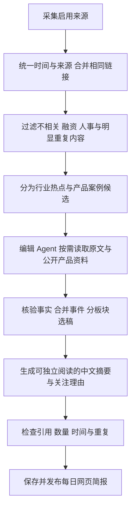

# AI Pulse Agent 产品定位与开发调整方案

日期：2026 年 10 月 28 日。项目目录：`E:\ai-pulse-agent`。

AI Pulse Agent 为关注 AI 的开发者及相关人员提供中文每日简报，让用户用 3 至 5 分钟了解重要行业动态，并发现真实、有新意的 AI 产品与应用案例。行业热点和产品案例各占一半；摘要本身应传达核心信息，用户不点击原文也能完成一次有价值的阅读。

当前优先验证个人日常使用价值，不考虑商业化。网页看板是第一版入口，云端模型由用户自行接入。已有本地版本提供了采集、存储、规则预览与调度基础，新定位所需的双板块选稿、完整中文编辑和质量标准仍需落实。

## 1 产品定位与目标用户

### 1.1 一句话定位

面向关注 AI 的开发者及相关人员，提供行业热点与真实产品案例各半的中文每日简报，以 3 至 5 分钟的阅读帮助用户了解前沿、发现值得进一步关注的应用。

### 1.2 首批用户

先以项目发起者本人为首位验证用户，再拓展到具有相似阅读习惯和需求的人：关注 AI 新能力、希望开发 AI 应用，但没有精力持续阅读英文资讯和多个中文媒体渠道。

这一人群可能具备开发能力，也可能主要依靠 AI 工具完成开发。第一版采用开发者能够理解的表达，同时解释影响理解的术语；不默认用户愿意阅读论文细节、模型榜单或工程配置。

### 1.3 两类阅读任务

用户打开看板后，应能完成两件事：了解当天值得知道的 AI 行业变化，以及发现真实产品中值得了解的新场景与新玩法。

对特别感兴趣的内容，用户可以继续查看原文、官网或演示。是否发生这一步不决定简报本身是否有价值。

## 2 用户经历与待解决的问题

| 用户经历 | 反映的需求 | 产品应提供的帮助 |
| --- | --- | --- |
| 希望开发 AI 应用，想从公众号和 TLDR 中学习，却没有动力每天逐个阅读 | 需要低负担的信息入口与应用案例发现 | 自动整理到每日网页简报，说明每条内容的核心信息 |
| 已订阅 TLDR 邮件，但经常没有心思打开，英文进一步增加负担 | 获得信息不等于愿意阅读 | 提供可以独立阅读的中文内容，降低理解成本 |
| 难以判断重要性 | 需要明确的编辑筛选依据 | 说明变化、适用场景和关注理由，而非只堆标题与链接 |
| 第一反应是确认有没有自己感兴趣的内容 | 需要容易浏览和快速判断的表达 | 标题具体、摘要完整、两类内容清楚区分 |

产品价值来自选稿与中文组织的共同作用。仅增加信息源、堆积热门链接或逐句翻译，并不能直接解决用户的阅读动力问题。

## 3 已确认的产品决策

| 维度 | 已确认决策 |
| --- | --- |
| 项目目标 | 做一个真正实用、愿意长期使用的项目，当前不考虑商业化 |
| 用户 | 关注 AI 前沿的开发者及相关人员 |
| 内容方向 | 行业热点与 AI 产品案例都需要，平均分配 |
| 行业热点 | 保留重要模型、产品和生态动态，不将范围收窄为开发点子 |
| 产品灵感 | 介绍真实存在的产品和玩法，由用户自行获得启发 |
| 排除内容 | 融资新闻、公司人事、同质化套壳产品 |
| 推荐方式 | 主动发现没想过但可能有启发的内容，拓展视野 |
| 阅读时间 | 默认每日 3 至 5 分钟，后续可能调整为动态模式 |
| 摘要价值 | 不点原文也能了解核心信息，并认为阅读有价值 |
| 产品入口 | 第一版通过网页看板；飞书机器人有既往使用经验，但本版暂不接入 |
| 数量与频率 | 延续每日最多 10 条、每天上午 9 点生成、不凑数的约定 |
| 国内外范围 | 国内外兼顾，默认来源可增删 |
| 模型与费用 | 用户自带云端 API，先测试效果与消耗，暂不设固定预算 |
| 本地环境 | Windows，E 盘项目目录，Conda Python 环境 |
| 开发顺序 | 先保证本地运行，模型先建模板，真实 API 接入测试放在最后 |

后文的摘要字数、展示细节、时间窗口和试用方法属于首版建议，允许通过实际试读调整。

## 4 每日内容结构

### 4.1 两个板块

| 板块 | 目标数量 | 用户读完应知道什么 |
| --- | --- | --- |
| 行业热点 | 约 5 条 | AI 领域发生了哪些重要变化，为什么值得知道 |
| 产品案例 | 约 5 条 | 哪些真实产品或玩法有新意，具体如何使用 AI |

首版建议各板块最多 5 条。某个板块只有 3 条合格内容时，发布 3 条，并不为填满另一板块而降低标准。平均分配是内容结构目标，不是强制凑出 10 条的指标。

同一条新闻和围绕它的重复报道合并处理。同一模型发布与官方演示如果主要传达相同变化，优先合为一条；独立产品确有不同场景和价值时，可以作为另一个案例入选。

### 4.2 行业热点的范围

优先选择重要模型发布、新能力与技术突破、主流 AI 产品的重大更新、影响开发者使用的 API 或价格变化，以及具有实际影响的生态事件。

摘要需要交代主体、变化、关键细节及意义。涉及性能结论时保留测试范围和来源属性；模型发布不能只剩“性能更强”，价格调整不能只剩“更加便宜”。

融资与公司人事按用户偏好排除。如果某篇文章同时涉及融资和实质产品发布，只考虑其中可以独立成立的产品事实，不把融资作为入选理由。

### 4.3 产品案例的范围

案例来自真实发布的产品、已公开演示的应用或可访问的开源项目。优先考虑场景有新意、玩法容易理解、AI 所起作用明确的内容，不要求所有产品都已商业成熟。

摘要至少说明目标用户、具体问题、产品怎样工作，以及它值得关注的新意。能找到官网、演示、文档或项目地址时优先关联；只有媒体描述时说明材料范围。

本板块不要求 Agent 构思尚不存在的产品，也不把推想写成已实现功能。

### 4.4 同质化套壳产品的建议判断

重点看产品是否带来新的场景价值、工作流程或使用体验。调用现成模型本身不作为淘汰依据。

仅更换品牌、界面或提示词包装，且没有可解释的新用途与体验的产品，通常不收录；类似产品如果解决了特定人群的实际问题，则说明其具体差异后再判断。

## 5 中文摘要与阅读体验

### 5.1 每条内容的结构

| 内容 | 行业热点 | 产品案例 |
| --- | --- | --- |
| 中文标题 | 主体加关键变化，避免只有情绪表达 | 产品或玩法加具体用途 |
| 核心摘要 | 发生了什么、有哪些关键变化 | 为谁解决什么、如何使用 AI |
| 关注理由 | 变化对用户或行业有什么意义 | 新意体现在哪里，为何值得了解 |
| 来源与时间 | 原文、报道来源和时间类型 | 官网、演示、文档或项目与时间类型 |
| 延伸阅读 | 原始公告或关联证据 | 产品页面、演示与项目地址 |

建议每条核心摘要约 80 至 130 个汉字，关注理由约 15 至 30 字。整份主要正文以约 1200 至 1800 字作为试读起点，实际以用户是否能舒适地在 3 至 5 分钟内读完为准，不机械截断信息来满足字数。

专有名称可以保留英文，解释性内容使用中文。必要术语简短解释，不把原文翻译成同样难读的中文术语堆叠。

### 5.2 摘要应完成的信息交付

用户只阅读摘要，就应能回答“这条消息讲了什么”和“为什么值得知道”。产品案例还应能回答“这个产品是给谁、用来做什么的”。

原文链接承担追溯、了解细节和试用的作用。摘要避免使用“重磅发布，详情见原文”之类无法独立传达内容的写法，也不为获得点击刻意省略关键事实。

### 5.3 网页看板

首页优先呈现日期、阅读时间提示、行业热点和产品案例。默认按板块阅读，支持快速定位另一板块。来源覆盖情况保留，但详细采集数据和任务日志放入管理页面。

每张卡片直接显示完整核心摘要与关注理由，证据细节可展开。产品官网、演示或 GitHub 地址使用清楚的入口名称，减少用户判断链接用途的成本。

初次使用和模型未接入时明确展示演示或规则预览。规则预览可验证采集与页面流程，完整中文简报的产品效果需要最后接入模型后验收。

## 6 信息源与可信度

### 6.1 来源构成

| 来源类别 | 首版范围 | 主要用途 |
| --- | --- | --- |
| 国外综合与 AI 资讯 | Hacker News、TLDR AI、TLDR 科技主刊 | 发现热点、产品与开源项目线索 |
| 国内媒体 | 机器之心、量子位、新智元 | 国内外动态的中文报道和产品案例 |
| 补充候选 | AI科技评论、极客公园、InfoQ | 扩展技术、产品和应用实践视角 |
| 官方信息 | 模型厂商博客、公告、发布文档 | 补充内容并核验关键事实 |
| GitHub | AI 主题搜索、媒体与社区外链、项目公开资料 | 发现真实项目并确认功能与热度依据 |

来源名称是关注清单，能否完整自动获取取决于实际渠道。各来源的已验证状态见 SOURCE_STATUS.md；该表是最近开发验证的记录，不等同于持续可用保证。

### 6.2 公众号的接入原则

优先验证公开免费入口，再考虑同媒体官网和可用订阅渠道。实际采集官网时，标注官网替代，不写成已完整覆盖公众号。

目前量子位官网已有成功采集记录，机器之心解析仍需适配，极客公园存在访问限制，新智元等公众号尚待免费自动入口验证。保留来源状态和手动添加文章链接的能力；需要登录或付费时另行评估。

### 6.3 热度与事实的区别

HN 得分、讨论量、GitHub Star 等用于发现候选，不自动证明重要性、真实性或产品质量。行业热点结合实际影响选稿，产品案例结合具体场景和新意选稿。

GitHub Star 增长必须来自实际快照和观测时间。没有历史时标注首次观察；API 没有返回总 Star 时标记待获取。跨多日采样不能改写成精确的单日增长。

### 6.4 时间与引用

保留原始发布、社区提交、期刊日期和采集时间的差别；未知时间明确表示。首次与长时间离线补生成可最多回溯 72 小时，避免把旧闻统一写成今日发布。

同一事件保留多个来源，尽量引用最接近原始事实的材料。材料仅来自媒体时不标记官方已确认；只有标题时不扩写未经证实的功能和数值。

## 7 编辑与 Agent 工作流

程序负责定时、采集、字段整理、候选规模控制、持久化和结构校验。单个编辑 Agent 负责按需查证、事件合并、内容判断和中文组织，不需要为了项目形式引入多个 Agent。

沿用有限只读工具：读取文章、读取仓库说明、查找已配置范围内的相关证据、查询历史报道。网页和仓库内容作为资料，不执行其中的指令，也不运行项目代码。

先按内容准则选择，再用可用的热度、时效和多源信息辅助排序。首版不急于建立复杂评分公式或根据少量点击自动训练兴趣模型。

查证失败、来源不足或候选不合格时减少条数。模型生成的引用必须关联真实记录，不能编造链接。若模型调用失败，保留上一份成功简报并显示任务状态。

## 8 推荐与后续动态调整

### 8.1 首版发现策略

在 AI 主题范围内保留不同厂商、领域和产品形态，帮助用户接触没想过的内容。不同来源对同一事件的报道不挤占多个名额，不设置国内外固定配额。

用户没有点击原文，不能据此判断不感兴趣；可能已经从摘要中获得所需信息。首版以内容准则和主动试读反馈调整选稿。

### 8.2 后续可以调整的内容

阅读时长、条数、摘要详略和两板块比例都可以演进。第一版保留结构清晰的内容数据，先用默认 3 至 5 分钟、目标各 5 条的模式验证。

动态调整的具体机制暂不确定。后续可以评估用户主动选择阅读档位，或根据明确反馈提出调整建议；不先把它承诺为复杂个性化推荐功能。

飞书推送作为独立的后续渠道，待网页简报形成稳定价值后再接入。新增渠道不替代选稿和摘要质量验证。

## 9 第一版范围与技术约束

### 9.1 第一版应交付

1. 行业热点与产品案例两个内容板块，目标各 5 条、每日合计最多 10 条。
2. 能独立阅读的中文标题、摘要、关注理由和可追溯来源。
3. 默认来源清单及增删、启停、连接状态，公众号覆盖缺口透明展示。
4. 每日生成、手动生成、历史修订、运行记录和失败状态。
5. Windows 本地运行，启动与使用说明足够清楚。
6. 用户自带模型配置、真实兼容性测试入口和用量记录。

### 9.2 后续考虑

阅读时长动态调整、显式兴趣反馈、收藏、飞书推送及更多来源适配，在真实试用后安排。当前不做商业化、公开多用户服务、原创产品点子生成或全网无限检索。

### 9.3 保留的技术路线

开发目录为 `E:\ai-pulse-agent`，使用项目内 Conda 环境和 Python 3.12；Web 为 FastAPI、Jinja2、CSS 与少量 JavaScript，存储使用 SQLite。网页资源本地提供，不额外搭建前端构建链。

默认本机单用户，每天 09:00 按 Asia/Hong_Kong 时区触发生成。程序运行时才采集，关机错过后补最新一份，不连续补跑多天。

模型 API 由用户提供接口、模型名称和密钥；先完成本地流程，最后执行真实接入验证。费用先记录和实测，当前不设置未经确认的固定预算。不自动购买第三方采集服务。

用户指定的开发约束继续原文保留：

> 入口只校验一次，拒绝重复判空和滥用try/catch；单次逻辑不乱抽函数，低概率防御先征求同意

## 10 当前版本与新定位的差距

以下对比记录本轮调整启动时的基础与实施目标。双板块代码现已按用户授权实施，最新进度见 LOCAL_STATUS.md；功能测试通过不等同于真实模型的内容体验已经验收。

| 方面 | 当前基础 | 接下来需要的调整 |
| --- | --- | --- |
| 本地环境与页面 | Conda 环境及五个页面已有 | 保留基础，按阅读任务调整首页 |
| 内容分类 | 主要按新闻与仓库类型展示 | 改为行业热点与产品案例；产品案例可以来自网站或仓库 |
| 内容数量 | 合计最多 10 条，统一排序 | 分板块选稿，目标各 5 条，不因一侧不足而凑数 |
| 摘要 | 当前规则预览保留原文语言，部分条目没有摘要 | 实现完整中文内容编辑与验收 |
| 产品价值表达 | 使用通用关注理由 | 对热点讲变化与意义，对案例讲人群、场景与新意 |
| 重复控制 | 链接与相同标题去重已有 | 模型接入后核验跨来源同事件的合并效果 |
| 来源覆盖 | 最近验证有 7 路成功，国内部分渠道有缺口 | 继续适配并维持准确状态，不把候选清单等同于已覆盖 |
| GitHub 发现 | 主题搜索、社区链接和快照已有 | 热度作辅助，是否入选取决于内容所属板块与具体价值 |
| 模型 | 配置与适配代码已有，无真实调用记录 | 最后验证实际模型的工具调用、结构化输出和中文编辑能力 |
| 评价方式 | 基础功能测试已有 | 加入真实试读，判断独立阅读价值和持续使用意愿 |

## 11 开发调整顺序

### 第一步 明确选稿规范与样例

将本方案作为产品定位依据，补充少量带真实出处的参考内容：重要热点、新产品、有差异的 API 应用、重复报道，以及应排除的融资、人事和同质化产品。样例用于比较选稿与摘要效果，不编造实时新闻。

交付为两类内容的结构和编辑样例，使后续实现具有可比较的目标。

### 第二步 调整本地流程与页面

在现有基础上增加独立于技术来源的板块字段，调整首页和历史展示，落实两个板块的数量规则。继续使用明确标注的演示与规则预览验证流程，不将它们当作模型效果。

交付为符合新结构、可以本地运行的页面与任务链路。

### 第三步 完善来源与 Agent 模板

优先修复能提升实际覆盖的来源问题，记录公众号缺口。按两类内容改写编辑提示词和结构化输出，落实排除规则、证据、时间与合并要求；默认仍不调用真实模型。

交付为准备好接入的采集流程、工具和编辑模板。

### 第四步 最后进行模型接入测试

用户配置实际接口、模型与密钥后，测试真实工具调用、结构化输出和完整简报。在同一组候选上对比中文事实准确性、选稿质量、耗时与成本。兼容性通过后，再使用真实模型进行每日生成。

交付为通过实际验证的模型配置、真实中文简报与费用记录。密钥未配置时，此项保持待完成。

### 第五步 试用后决定后续范围

建议先连续试读约一周，按阅读体验调整条数、长度和选稿。网页形成稳定价值后，再决定动态调整和飞书推送的优先级。

GitHub 开源发布继续保留为后续交付，待实现审阅、远程仓库设置与授权明确后再执行。

## 12 验收与效果评价

### 12.1 内容验收

每份简报应符合以下要求：两板块结构明确；总数不超过 10；不为名额降低质量；排除已明确不想看的内容；产品案例真实且价值可以说明；摘要使用中文并能独立理解；数值、功能、时间和引用有依据；同一事件没有明显重复。

模型摘要应区分来源事实与编辑判断，不把厂商宣传直接写成已被验证的客观结论。无原文、无正文或无热度历史时，应按实际材料范围表达。

### 12.2 阅读体验评价

主要观察用户能否舒适地在 3 至 5 分钟内读完，读完是否掌握值得知道的变化、发现有兴趣的真实案例，以及接下来几天是否愿意继续打开。

建议试读时只记录三个问题：今天读了多久、有几条觉得值得知道、有没有明显漏掉的重要内容或不想看的内容。初期手动记录即可，不为试用先建设埋点系统。

有用条数占已阅读条数的比例、主动阅读天数和负面反馈类型可作为后续比较依据。首轮先取得基线，不把未经验证的目标数字写成已达成效果。

点击率仅用于了解哪些内容引发进一步探索；不点击不作为负反馈。长停留也不自动代表喜欢，需要结合用户是否读懂与觉得有用判断。

### 12.3 工程验收

现有采集、存储、时间窗口、任务合并、历史与配置测试继续保留。新增测试聚焦板块归属、每板块数量、跨来源重复、排除规则，以及结构化输出中的证据关联。

真实模型测试与本地固定样例分别记录。没有密钥时可以运行本地测试，但不能标记真实 Agent 编辑能力已通过验收。

## 13 产品假设与实施边界

仍需试用验证的核心假设是：中文选稿与完整摘要能提升实际阅读意愿；约各 5 条的结构适合用户；3 至 5 分钟能兼顾行业了解与案例发现；在保留新鲜内容时仍能维持相关性。

这些假设通过真实简报试读验证，而不是通过信息源数量、采集条数或页面完成度替代。公众号渠道、模型质量与预算分别记录实际限制。

本方案记录产品目标与开发调整依据，不代表所有目标已验收。用户已授权按本方案更新本地代码；双板块、选稿模板和页面的实施状态见 LOCAL_STATUS.md。真实模型连接、公众号覆盖及阅读质量仍按实际验证记录，后续范围以用户最新指令为准。

## 14 与现有文档的关系

产品目标、内容结构、选稿和阅读体验以本方案及后续用户修订为准。原 DEVELOPMENT_PLAN.md 保留技术细节与早期规划；涉及单一新闻列表、以 GitHub 热度主导内容等不一致处，按新定位调整。

LOCAL_STATUS.md 和 SOURCE_STATUS.md 说明已验证的工程与来源状态，不因本方案的目标描述而变成已完成。DEVELOPMENT_PROMPT.md 保留用户编码约束，下一次实施时需与本方案的内容要求同步。
